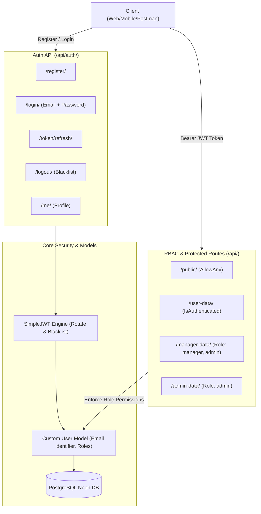

# Implementation Plan: Secure JWT Authentication & RBAC

This document outlines the detailed architecture and implementation plan for building a production-grade, secure JWT authentication system with a custom email-based User model, Role-Based Access Control (RBAC), and protected REST API endpoints in Django.

## Goal Description
The project is currently a freshly initialized Django 6.1.3 application with a Neon PostgreSQL database connection and zero migrations applied.
The goal is to:
1. Establish a **Custom User Model** (`users.User`) using `email` as the unique username identifier, complete with custom `UserManager` and role support.
2. Build an **Email-Password Authentication** flow using Django REST Framework (DRF) and `djangorestframework-simplejwt`.
3. Implement a **Secure JWT System** featuring:
   - Access & refresh token generation with customized token claims (`user_id`, `email`, `role`).
   - Token rotation and automatic blacklisting (`rest_framework_simplejwt.token_blacklist`).
   - Safe expiration timeouts.
   - Registration, login, token refresh, token blacklist (logout), and user profile endpoints.
4. Build a robust **Role-Based Access Control (RBAC)** architecture:
   - Defined user roles (`admin`, `manager`, `user`).
   - Granular, reusable DRF custom permissions (`IsAdminUserRole`, `IsManagerUserRole`, `RoleRequired(['admin', 'manager'])`, `IsOwnerOrAdmin`).
5. Expose and verify **Protected REST API Routes** demonstrating tier-based access restrictions.

---

## User Review Required

> [!IMPORTANT]
> **Database Migrations Timing**: Since no migrations have been applied to PostgreSQL yet (`0001_initial` is unapplied), introducing `AUTH_USER_MODEL = 'users.User'` right now is completely clean and will avoid any legacy migration conflicts. We will install dependencies and apply initial migrations as part of this implementation.

> [!NOTE]
> **Roles Structure**: We propose 3 standard roles by default:
> - `admin`: Full platform and user management access.
> - `manager`: Intermediate access (access to reports/management data).
> - `user`: Standard customer/client role (access only to self and regular protected endpoints).
> *Superusers* (`is_superuser=True`) will automatically bypass role checks or default to `admin`.

---

## Proposed Architecture



---

## Proposed Changes

### 1. Dependencies & Configuration

#### [MODIFY] [requirements.txt](file:///c:/Users/HP/Desktop/Django/myproject/requirements.txt)
Add required packages:
- `djangorestframework`
- `djangorestframework-simplejwt`

#### [MODIFY] [config/settings.py](file:///c:/Users/HP/Desktop/Django/myproject/config/settings.py)
- Register `rest_framework`, `rest_framework_simplejwt`, `rest_framework_simplejwt.token_blacklist`, and new app `users`.
- Configure `AUTH_USER_MODEL = "users.User"`.
- Configure `REST_FRAMEWORK` settings:
  - Default Authentication Class: `rest_framework_simplejwt.authentication.JWTAuthentication`
  - Default Permission Class: `rest_framework.permissions.IsAuthenticated`
  - Renderers: JSONRenderer (+ BrowsableAPIRenderer in DEBUG).
- Configure `SIMPLE_JWT` settings:
  - `ACCESS_TOKEN_LIFETIME = timedelta(minutes=15)`
  - `REFRESH_TOKEN_LIFETIME = timedelta(days=7)`
  - `ROTATE_REFRESH_TOKENS = True`
  - `BLACKLIST_AFTER_ROTATION = True`
  - `AUTH_HEADER_TYPES = ('Bearer',)`
  - Custom serializer configuration for claims.

---

### 2. Custom User Model & App (`users`)

Create a clean app `users` for account management and RBAC.

#### [NEW] `users/models.py`
- `UserRole(models.TextChoices)`: `ADMIN = "admin", "Admin"`, `MANAGER = "manager", "Manager"`, `USER = "user", "User"`.
- `UserManager(BaseUserManager)`:
  - `create_user(email, password=None, **extra_fields)`: Normalizes email, handles lowercasing, hashes password.
  - `create_superuser(email, password=None, **extra_fields)`: Enforces `is_staff=True`, `is_superuser=True`, `role=admin`.
- `User(AbstractBaseUser, PermissionsMixin)`:
  - `email = models.EmailField(unique=True, db_index=True)`
  - `first_name = models.CharField(max_length=150, blank=True)`
  - `last_name = models.CharField(max_length=150, blank=True)`
  - `role = models.CharField(max_length=20, choices=UserRole.choices, default=UserRole.USER)`
  - `is_active = models.BooleanField(default=True)`
  - `is_staff = models.BooleanField(default=False)`
  - `created_at = models.DateTimeField(auto_now_add=True)`
  - `updated_at = models.DateTimeField(auto_now=True)`
  - `USERNAME_FIELD = "email"`
  - `REQUIRED_FIELDS = []`

#### [NEW] `users/admin.py`
- Custom `UserAdmin` subclassing `django.contrib.auth.admin.UserAdmin` configured for `email` as primary identifier (removing username-specific form fields and ordering by email).

---

### 3. JWT Authentication & Serializers

#### [NEW] `users/serializers.py`
- `EmailTokenObtainPairSerializer(TokenObtainPairSerializer)`:
  - Validates `email` and `password`.
  - Injects `role`, `email`, and `user_id` into JWT payload claims.
  - Adds user metadata (`email`, `role`, `first_name`, `last_name`) to login response body.
- `UserRegisterSerializer(serializers.ModelSerializer)`:
  - Validates email uniqueness, password confirmation and strength.
  - Creates user safely with hashed password using `create_user()`.
- `UserProfileSerializer(serializers.ModelSerializer)`:
  - Read/update serializer for authenticated user profile (`id`, `email`, `first_name`, `last_name`, `role`, `created_at`).
- `LogoutSerializer(serializers.Serializer)`:
  - Takes `refresh` token string and blacklists it via SimpleJWT's `RefreshToken(token).blacklist()`.

---

### 4. Role-Based Access Control (RBAC) Permissions

#### [NEW] `users/permissions.py`
- `HasRole`: Helper base class taking allowed roles.
- `IsAdmin`: Allows access only to users with `role == 'admin'` or `is_superuser`.
- `IsManager`: Allows access to `role in ['manager', 'admin']` or `is_superuser`.
- `IsOwnerOrAdmin`: Object-level permission checking if `obj == request.user` or `request.user.role == 'admin'`.
- Dynamic factory `RequireRole(*roles)`: Utility function or permission class to easily secure any endpoint with any combination of roles.

---

### 5. API Views & Protected Routes

#### [NEW] `users/views.py`
Authentication views:
- `RegisterView(generics.CreateAPIView)`: `permission_classes = [AllowAny]`
- `EmailTokenObtainPairView(TokenObtainPairView)`: custom token obtain endpoint.
- `LogoutView(APIView)`: `permission_classes = [IsAuthenticated]`, blacklists provided refresh token.
- `UserProfileView(generics.RetrieveUpdateAPIView)`: `permission_classes = [IsAuthenticated]`.

Sample Protected & Demonstration routes:
- `PublicTestView`: `permission_classes = [AllowAny]`
- `UserProtectedView`: `permission_classes = [IsAuthenticated]` (accessible by user, manager, admin)
- `ManagerProtectedView`: `permission_classes = [IsAuthenticated, IsManager]` (accessible by manager and admin)
- `AdminProtectedView`: `permission_classes = [IsAuthenticated, IsAdmin]` (accessible strictly by admin)

#### [NEW] `users/urls.py`
- `/api/auth/register/`
- `/api/auth/login/`
- `/api/auth/token/refresh/`
- `/api/auth/logout/`
- `/api/auth/me/`
- `/api/test/public/`
- `/api/test/user/`
- `/api/test/manager/`
- `/api/test/admin/`

#### [MODIFY] [config/urls.py](file:///c:/Users/HP/Desktop/Django/myproject/config/urls.py)
- Wire `path("api/", include("users.urls"))`.

---

## Verification Plan

### Automated Tests
Create automated tests in `users/tests.py` covering:
1. **User Model Tests**:
   - Creating user with email & password.
   - Creating superuser with proper flags and role.
   - Normalization and duplicate email rejection.
2. **Authentication Flow Tests**:
   - Registration with valid/invalid data.
   - Login with email and password -> returns JWT access & refresh tokens.
   - Accessing protected route with valid JWT -> `200 OK`.
   - Accessing protected route with invalid/expired/missing JWT -> `401 Unauthorized`.
   - Token refresh flow -> obtains new valid access token.
   - Logout / blacklisting -> refreshed token cannot be used again.
3. **RBAC Tests**:
   - Standard user accessing User route (`200 OK`), Manager route (`403 Forbidden`), Admin route (`403 Forbidden`).
   - Manager accessing User route (`200 OK`), Manager route (`200 OK`), Admin route (`403 Forbidden`).
   - Admin accessing User route (`200 OK`), Manager route (`200 OK`), Admin route (`200 OK`).

Run command:
```powershell
.\venv\Scripts\python.exe manage.py test users
```

### Manual Verification
1. Run `manage.py makemigrations users` and `manage.py migrate`.
2. Inspect endpoint responses via automated test suite and curl / powershell requests.

## Additional Notes

1. **User & Profile models**  
   - We'll define a `User` model (custom, email‑based) and a separate `Profile` model linked via a `OneToOneField` (`user = models.OneToOneField(User, on_delete=models.CASCADE, related_name='profile')`).  
   - The ERD will show `User` ↔︎ `Profile` one‑to‑one.

2. **Function‑based views**  
   - All auth and profile endpoints will be implemented as FBVs using `@api_view` and appropriate serializers, rather than class‑based views.  
   - This aligns with the request for FBVs + serializers.
